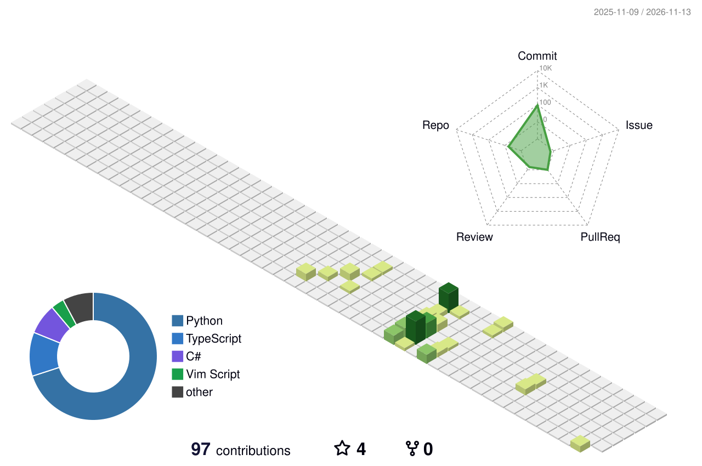

<!-- GitHub profile README · todayair
     仅使用 GitHub 支持的 Markdown / HTML；不依赖 CSS 或 JavaScript。
     项目介绍以对应公开仓库 README 为依据，Fork 项目单独标注。
     统计徽章由第三方实时提供，贡献图由本仓库既有 Actions 更新。
-->

  

  <h3>一个正在学习 Agent 开发的学生</h3>
  
<em>随着浪花起伏消没 叼啄着往昔飞离不见</em>

  

    
    
    
  

## 关于我

永远不要渴求他人真正理解你，也不要一厢情愿的认为自己真正理解他人。

**很期待和你共同创造一片天地。**

  
  
  

## 项目作品

### 01 · [Personal Assistant Agent](https://github.com/todayair/todayair-personal-assistant-agent)

基于 **Pydantic AI + Harness** 构建的交互式 AI 助手。

AI Agent · TypeScript

### 02 · [TodayAir Dianping](https://github.com/todayair/Dianping)

基于 **Spring Boot + Redis + RabbitMQ** 的本地生活服务平台后端，围绕商铺查询、秒杀与博客社交展开。

Java · Spring Boot · Redis · RabbitMQ · MySQL

### 03 · [学生协作聊天室](https://github.com/todayair/Student-Collaboration-Chatroom)

基于 **C# / .NET 8 + WPF** 的学生协作沟通平台，支持实时聊天、房间管理、课程匹配与文件分享。

C# · WPF · TCP · MySQL

  
<b>学习与探索 · Fork 项目</b>

   

- [all-in-rag](https://github.com/todayair/all-in-rag) — RAG 技术全栈指南，Fork 自 [Datawhale](https://github.com/datawhalechina/all-in-rag)。
- [Ommateum](https://github.com/todayair/Ommateum) — 通用视觉缺陷检测平台，Fork 自 [x1a0qiya/Ommateum](https://github.com/x1a0qiya/Ommateum)。

## 代码足迹

  <picture>
    <source media="(prefers-color-scheme: dark)" srcset="https://github-profile-summary-cards.vercel.app/api/cards/stats?username=todayair&amp;theme=github_dark" />
    
  </picture>
  <picture>
    <source media="(prefers-color-scheme: dark)" srcset="https://github-profile-summary-cards.vercel.app/api/cards/most-commit-language?username=todayair&amp;theme=github_dark" />
    
  </picture>

语言分布按提交记录统计，不代表熟练度；统计卡片由第三方服务提供。

### 每一次提交，都留下一点痕迹

  <picture>
    <source media="(prefers-color-scheme: dark)" srcset="https://raw.githubusercontent.com/todayair/todayair/main/profile-3d-contrib/profile-night-green.svg" />
    
  </picture>

  
<b>展开更多 · 活跃概览与贡献小蛇</b>

   

  

    <picture>
      <source media="(prefers-color-scheme: dark)" srcset="https://github-profile-summary-cards.vercel.app/api/cards/profile-details?username=todayair&amp;theme=github_dark" />
      
    </picture>
  

  

    <picture>
      <source media="(prefers-color-scheme: dark)" srcset="https://raw.githubusercontent.com/todayair/todayair/output/github-contribution-grid-snake-dark.svg" />
      
    </picture>
  

---

很期待和你共同创造一片天地。

